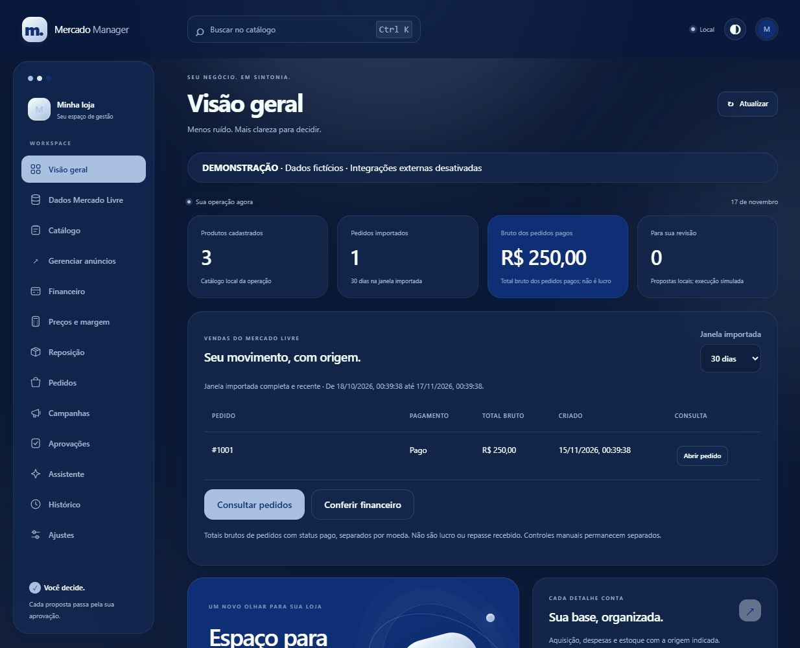
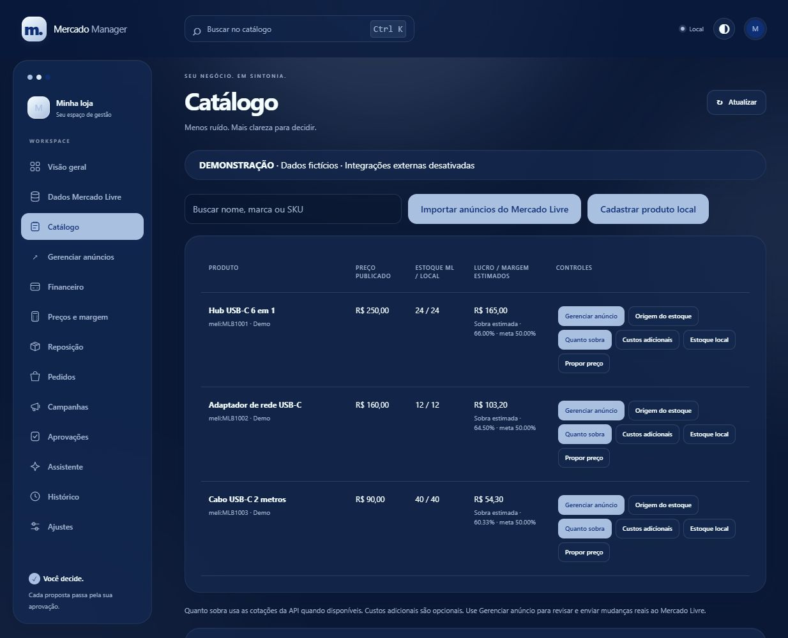
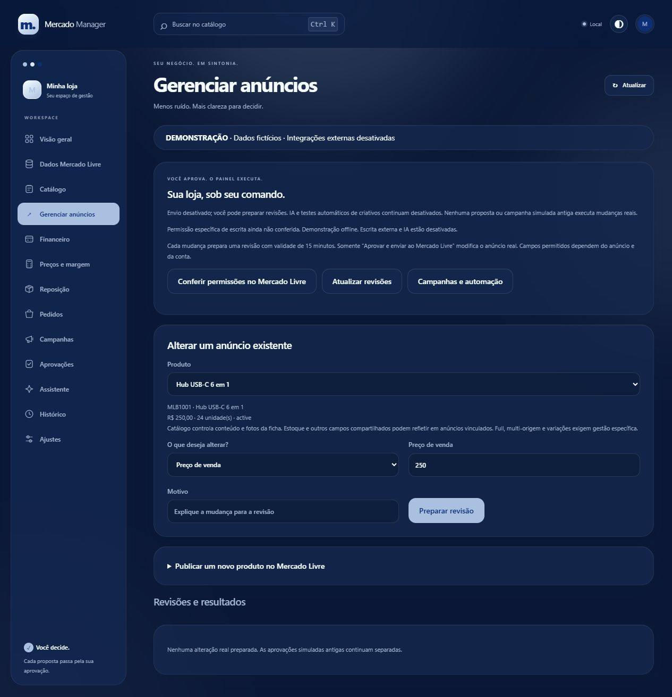
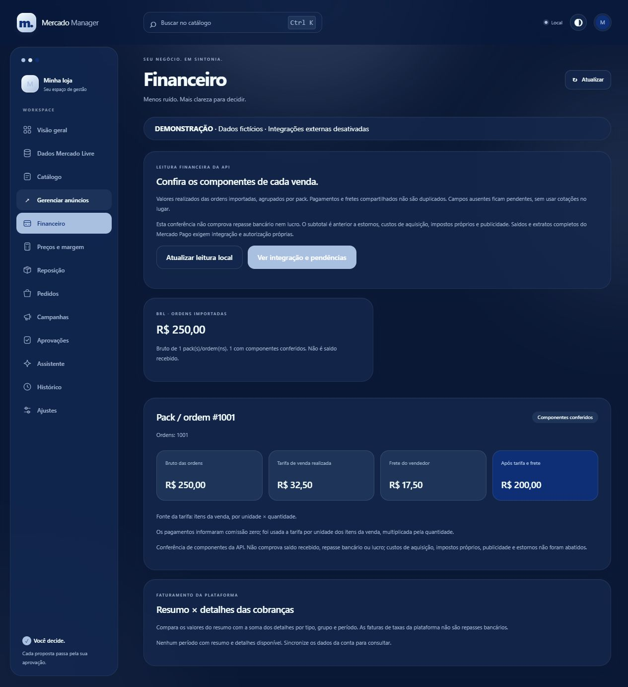
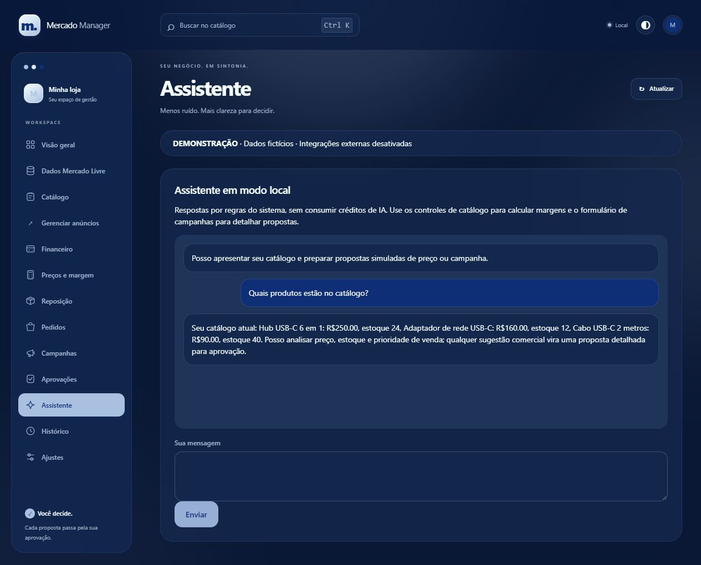
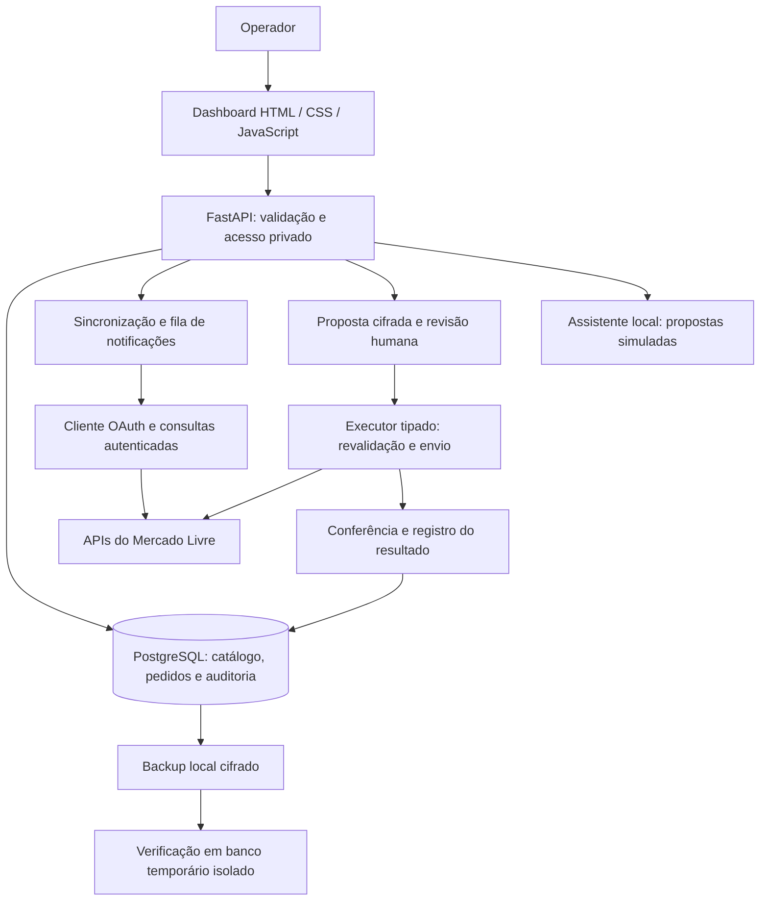

<div align="center">

# Mercado Manager

**Gestão de marketplace com dados rastreáveis, segurança e aprovação humana.**

Projeto pessoal full stack para centralizar catálogo, pedidos, tarifas, estoque e alterações de anúncios do Mercado Livre.

`Python` · `FastAPI` · `SQLAlchemy` · `PostgreSQL` · `JavaScript` · `Docker`

[Interface](#interface) · [Arquitetura](#arquitetura) · [Demonstração](#demonstração-sem-credenciais) · [Segurança](#segurança-e-privacidade) · [Testes](#testes)

</div>



> As cinco imagens foram capturadas na própria aplicação, em uma demonstração isolada. Produtos, pedidos, quantidades e valores são fictícios. O repositório não inclui credenciais nem dados da operação real.

## Sobre o projeto

Acompanhar uma loja exige consultar anúncios, conferir pedidos e entender quanto resta depois das cobranças da plataforma. O Mercado Manager reúne essas informações em um dashboard e mantém a origem dos dados e cálculos visível.

O projeto também implementa um fluxo de execução controlada: a mudança é preparada, revisada pelo operador, aprovada e conferida novamente na API. O objetivo de evolução é adicionar assistência por IA mantendo o vendedor no controle das decisões comerciais.

**Estado atual:** integração e controles operacionais implementados; assistente local com propostas simuladas. Campanhas autônomas e decisões comerciais por IA são próximas etapas.

## Funcionalidades implementadas

| Área | O que oferece |
|---|---|
| Visão geral | Indicadores, pedidos recentes, qualidade da importação e verificações da operação. |
| Catálogo | Importação, busca, estoque anunciado, custos e arquivamento de anúncios encerrados ou excluídos. |
| Gestão de anúncios | Revisão e aprovação de mudanças de preço, quantidade, status e conteúdo, conforme as regras do anúncio. Validação de novos produtos antes de publicar. |
| Financeiro | Componentes realizados da venda, tarifa por item ou pagamento, frete do vendedor e identificação de divergências. |
| Preços e margem | Estimativa de sobra, aquisição confirmada, meta de margem e comparação de cenários. |
| Estoque e reposição | Contagem física separada da quantidade anunciada, movimentos locais e planejamento de reposição. |
| Sincronização | Consultas agendadas, histórico, fila de notificações e indicação de recursos indisponíveis. |
| Acesso e auditoria | Operador único, sessões com expiração, limites de tentativas e registro das decisões. |
| Recuperação | Backup local cifrado, teste de restauração isolado e redefinição de senha pelo terminal local. |
| Assistente | Consulta ao catálogo e propostas comerciais simuladas em modo local. |

## Interface

### 1. Visão geral

A imagem de abertura mostra o painel inicial. Ele diferencia total bruto de pedidos pagos, quantidade de produtos e propostas pendentes. A janela importada aparece junto dos indicadores para não confundir uma consulta incompleta com ausência de vendas.

### 2. Catálogo e estoque

Preço publicado, quantidade anunciada, contagem física e margem são apresentados na mesma tela. Anúncios encerrados ou excluídos saem da operação atual e ficam arquivados, preservando pedidos e custos anteriores. Falhas de consulta não são tratadas automaticamente como exclusão.



### 3. Gerenciar anúncios

O operador prepara uma alteração e revisa os valores antes do envio. O servidor confere propriedade, estado do anúncio, permissões e validade da proposta. Mudanças de preço também passam pela meta de margem configurada.

Título, fotos e outros campos dependem das regras de catálogo, do modelo User Products, da logística e do estado da publicação. Na demonstração, os envios externos permanecem desativados.



### 4. Financeiro com origem dos componentes

O Financeiro separa bruto, tarifa e frete do vendedor. As representações da tarifa são comparadas, sem somar duas vezes a mesma cobrança. Pagamentos ou fretes compartilhados entre ordens exigem conferência antes da consolidação.

Neste exemplo fictício, a tarifa está nos itens da venda, mesmo que o campo dos pagamentos venha zerado. O subtotal é identificado como **valor após tarifa e frete**: ele não comprova repasse bancário ou lucro final.



### 5. Assistente em modo local

O assistente apresenta o catálogo e organiza propostas simuladas por regras do sistema. A interface informa esse modo de funcionamento. A IA ainda não está conectada ao executor de mudanças reais.



## Como funciona

1. **Conectar:** o vendedor autoriza seu aplicativo pelo fluxo OAuth do Mercado Livre.
2. **Consultar:** o backend importa os recursos permitidos e mantém cópias locais cifradas dos dados privados recebidos.
3. **Analisar:** catálogo, pedidos, custos e margem são apresentados com origem e pendências.
4. **Preparar:** a mudança comercial gera uma proposta imutável vinculada à conta e ao anúncio.
5. **Aprovar:** o operador revisa o conteúdo exato antes de autorizar o envio.
6. **Conferir:** o servidor consulta novamente o recurso e registra resultado, divergência ou ausência de confirmação.

Uma resposta perdida não provoca republicação automática. A conferência consulta o estado do recurso antes de uma nova decisão.

## Arquitetura



| Camada | Tecnologia | Responsabilidade |
|---|---|---|
| Interface | HTML, CSS e JavaScript | Navegação, formulários, revisão e apresentação dos dados. |
| Backend | Python e FastAPI | Validação, autenticação e coordenação das operações. |
| Persistência | SQLAlchemy e PostgreSQL | Dados operacionais, estados de execução, limites de acesso e auditoria. |
| Integração | HTTPX e OAuth com PKCE/state | Autorização, renovação de tokens e chamadas aos recursos permitidos. |
| Proteção dos dados | scrypt e cryptography | Hash de senha com salt, cifragem de tokens e proteção dos backups. |
| Ambiente | Docker Compose | Serviços da aplicação, banco e rotina de backup. |
| Testes | pytest, TestClient e MockTransport | Validação isolada com respostas simuladas do provedor. |

Na instalação operacional, o agendamento roda junto da API, em **um único processo**. A demonstração usa SQLite temporário e um provedor em memória; não utiliza o banco operacional.

### Organização do código

```text
app/
  main.py                     API e integração das rotas
  static/                     Dashboard HTML, CSS e JavaScript
  access.py / auth_guard.py   Login, sessões e limites de tentativas
  origins.py                  Origem HTTPS para proxy ou túnel
  services/mercadolivre.py    OAuth e consultas à plataforma
  data_hub.py / auto_sync.py  Coleta, agendamento e notificações
  catalog_sync.py             Reconciliação e arquivamento
  listing_manager.py          Propostas e execução aprovada
  api_completion.py           Leitura financeira e recursos complementares
  seller_proceeds.py          Estimativa de sobra e meta de margem
  operations.py               Controles locais e relatórios
  operator_recovery.py        Recuperação de acesso no terminal local
backup/                       Cópias cifradas e teste de restauração
tools/                        Configuração, demonstração e revisão de publicação
tests/                        Testes automatizados com dados fictícios
docs/                         Guias técnicos e capturas de demonstração
```

## Decisões técnicas

- **Dados ausentes não viram zero:** tarifa indisponível, moeda divergente ou histórico incompleto impedem uma conclusão financeira indevida.
- **Tarifa por unidade:** a comissão dos itens é multiplicada pela quantidade, não pelo número de pagamentos.
- **Histórico preservado:** arquivar um anúncio não apaga pedidos, custos ou contagens físicas.
- **Execução rastreável:** propostas com validade limitada, revisão do conteúdo exato, bloqueio de execução simultânea por vendedor e auditoria.
- **Falhas explícitas:** um envio sem confirmação fica pendente de conferência, sem repetição automática de publicação.
- **Segredos no servidor:** o navegador não recebe tokens OAuth ou chaves dos serviços.
- **Demonstração reproduzível:** o dashboard pode ser explorado com dados temporários e sem credenciais reais.

## Demonstração sem credenciais

Requisito: Python 3.12 ou superior.

```sh
python -m pip install -e ".[dev]"
python tools/demo_preview.py
```

Abra **http://127.0.0.1:8011**.

Esse modo cria uma base temporária com dados fictícios e substitui as consultas externas por respostas em memória. IA paga, agendamento e envios ao marketplace ficam desativados. O acesso sem senha existe somente nesse processo local de demonstração. Ao encerrar com `Ctrl + C`, a base temporária é descartada.

## Instalação com Docker

Requisitos: Python 3.12 ou superior e Docker com Compose. Use uma pasta e um volume novos para esta distribuição.

```sh
python -m pip install -e ".[dev]"
python tools/setup_local.py
docker compose build api
docker compose up -d --wait db
python tools/database_security.py restrict
docker compose up -d --build --wait
```

Abra **http://127.0.0.1:8000/login** e crie o acesso local.

`setup_local.py` gera um `.env` privado com senha de banco e chave de proteção novas, sem mostrá-las. A manutenção configura o esquema e uma conta restrita para a aplicação. Não substitua o `.env` ou o volume de uma instalação existente por arquivos da demonstração.

### Conectar o Mercado Livre

Configure no `.env` privado o identificador do seu aplicativo, o segredo e o callback HTTPS registrado no DevCenter. Depois recrie o serviço e use **Ajustes → Conectar ou renovar autorização**. Os tokens são recebidos e renovados pelo backend.

As permissões funcionais e a disponibilidade dos recursos dependem do aplicativo e da conta do vendedor. Para HTTPS por proxy ou túnel, configure `PUBLIC_BASE_URL` com a origem pública exata. A documentação interativa da API fica desativada por padrão.

## Segurança e privacidade

- `.env.example` com campos privados vazios; `.env` e suas variantes fora do Git.
- Senhas de banco geradas por instalação, sem valores fixos na configuração pública.
- Tokens cifrados em repouso, com chave na configuração privada do servidor.
- Senha de operador protegida por scrypt com salt; cookies HttpOnly e SameSite, com Secure no HTTPS.
- Expiração de sessão, limitação persistente de tentativas e validação de origem.
- Conta restrita de PostgreSQL após a configuração local.
- Backups, bancos, logs, capturas de tráfego, arquivos privados e caches excluídos do pacote público.
- Imagens desta apresentação recriadas com dados fictícios e revisadas antes da inclusão.

O projeto é de operador único. A recuperação de senha exige acesso ao terminal local e não cria uma rota pública de redefinição. Consulte [SECURITY.md](SECURITY.md) e [LOCAL-RECOVERY.md](docs/LOCAL-RECOVERY.md).

### Conferência antes de publicar

```sh
python tools/check_publication.py
```

Depois de iniciar um repositório e selecionar os arquivos:

```sh
python tools/check_publication.py --staged
```

O verificador mostra arquivo, linha e categoria, sem exibir credenciais. As imagens aprovadas têm hashes e origem de demonstração registrados em `docs/images/manifest.json`; arquivos binários novos ou alterados exigem revisão. O `.gitignore` não remove informações de commits antigos.

## Testes

```sh
python -m pytest -q
```

A suíte cobre autenticação, sessões, limites de tentativas, isolamento de dados, sincronização, arquivamento, cálculos financeiros, margem, revisão de alterações, idempotência, backups e publicação. Os testes usam bancos e credenciais descartáveis, sem executar alterações reais na conta de um vendedor.

## Limitações e próximas etapas

| Tema | Situação |
|---|---|
| IA autônoma | Ainda não integrada ao executor. O assistente atual gera propostas simuladas. |
| Campanhas pagas | Escrita e otimização automática ainda não implementadas; dependem também do acesso disponibilizado pelo provedor. |
| Testes de criativos | Comparação automática de fotos, títulos e carrosséis é uma etapa futura. |
| Repasses | A leitura de componentes não substitui conciliação completa do Mercado Pago ou confirmação de crédito bancário. |
| Operação contínua | Hospedagem, monitoramento, migrações versionadas e backup fora da máquina são evoluções da implantação. |
| Múltiplos vendedores | O isolamento completo de todas as áreas entre contas ainda exige evolução e validação antes de uma oferta multiusuário. |
| Escrita real | O executor está implementado; cada fluxo deve ser validado com uma alteração concreta aprovada e permitida pela plataforma. |

## Documentação

| Guia | Conteúdo |
|---|---|
| [Arquitetura](docs/ARCHITECTURE.md) | Componentes e decisões de implementação. |
| [Catálogo](docs/CATALOG-SYNC.md) | Paginação, estados e preservação de histórico. |
| [Gestão de anúncios](docs/LISTING-MANAGER.md) | Preparação, aprovação, execução e conferência. |
| [Tarifas realizadas](docs/REALIZED-FEES.md) | Fontes da tarifa, quantidade e pagamentos divididos. |
| [Estimativa de sobra](docs/SELLER-PROCEEDS.md) | Cotações da API e meta de margem. |
| [Sincronização](docs/AUTO-SYNC.md) | Agendamento, notificações e recuperação. |
| [Acesso privado](docs/PRIVATE-ACCESS.md) | Autenticação e sessões. |
| [Login HTTPS](docs/HTTPS-LOGIN.md) | Origem pública para proxy ou túnel. |
| [Backup](docs/BACKUP.md) | Cifragem e restauração isolada. |

---

Projeto pessoal de portfólio e integração independente, sem vínculo oficial com o Mercado Livre. As telas mostram o software implementado; as funcionalidades planejadas estão identificadas como próximas etapas.
